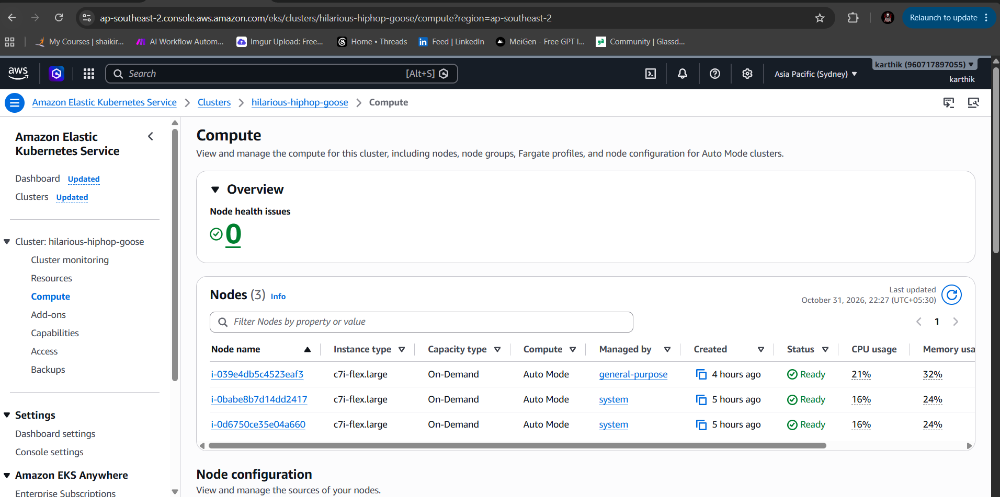
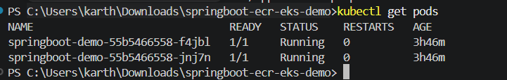
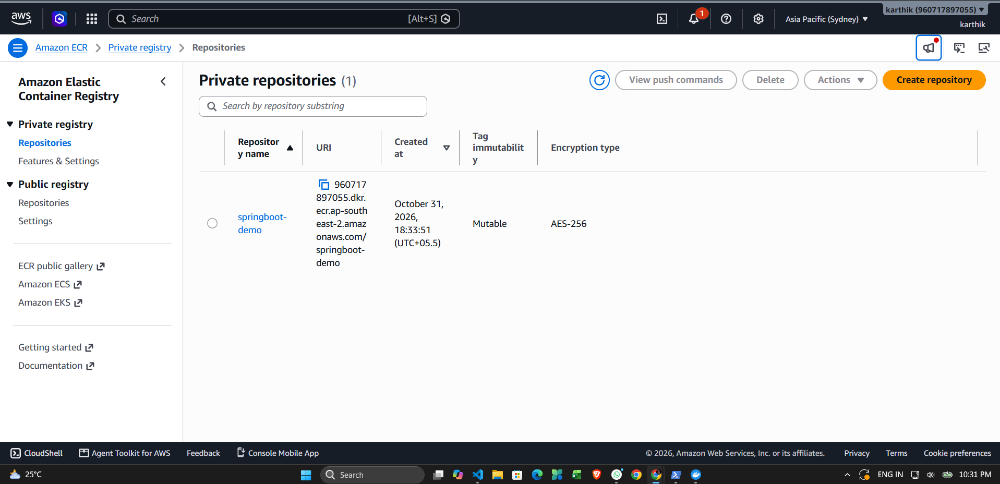
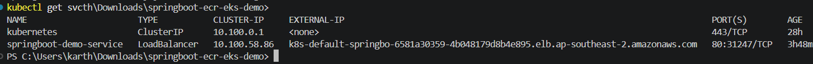
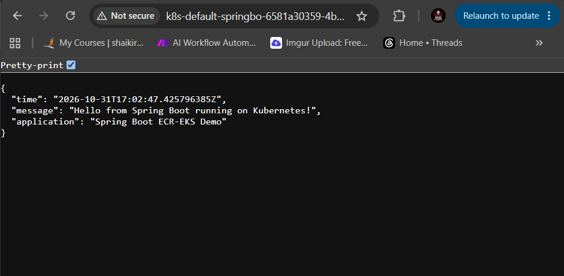
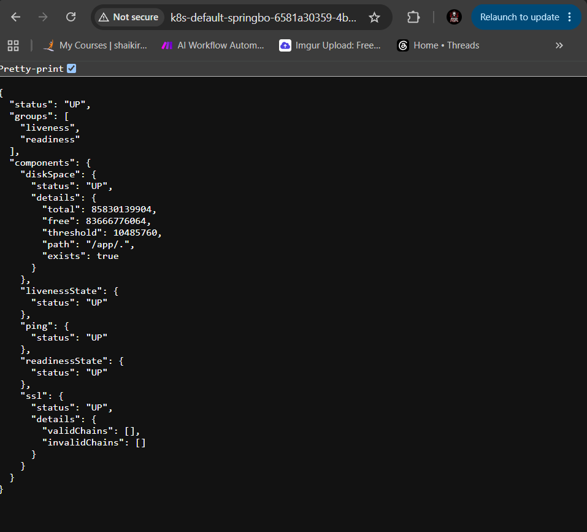
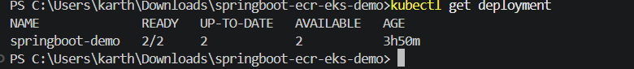
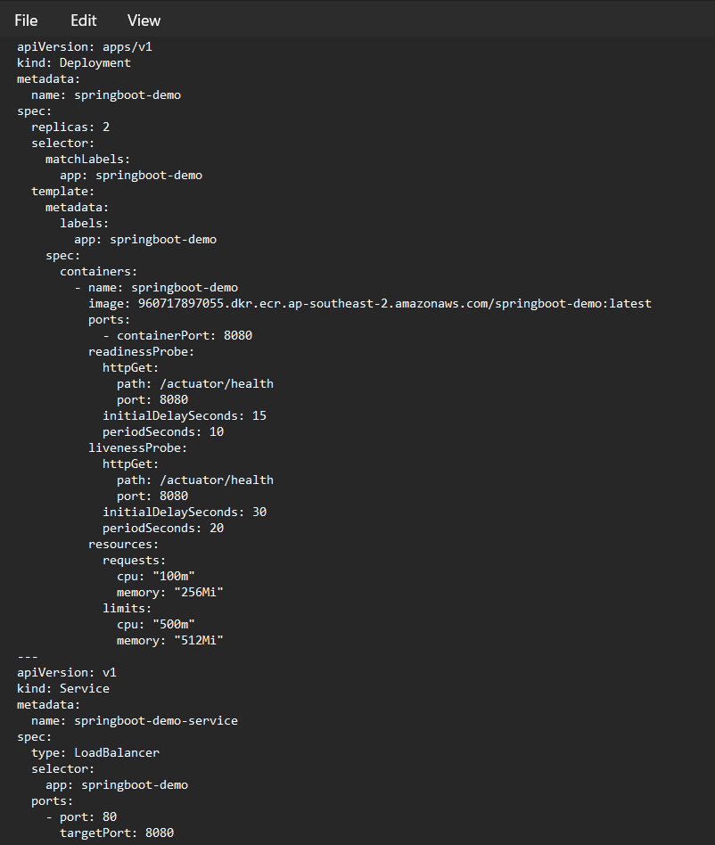
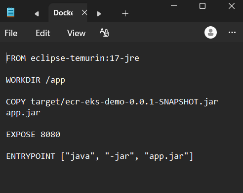
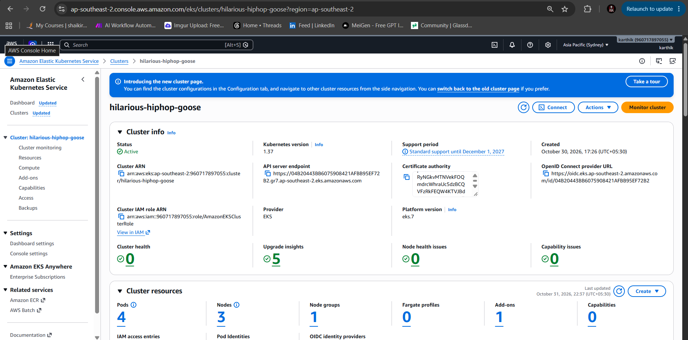

# Spring Boot → Docker → Amazon ECR → Amazon EKS

A beginner-friendly cloud deployment project that demonstrates how to build a Spring Boot application, package it with Maven, containerize it with Docker, push the image to Amazon Elastic Container Registry (ECR), and deploy it to Amazon Elastic Kubernetes Service (EKS) using Kubernetes.

## 📌 Project Overview

This project demonstrates how to deploy a Spring Boot application on AWS using Docker, Amazon ECR, Amazon EKS, and Kubernetes.

The application was:

- Built with Spring Boot
- Packaged using Maven
- Containerized using Docker
- Pushed to Amazon ECR
- Deployed to Amazon EKS
- Managed using Kubernetes
- Exposed through an AWS Network Load Balancer
- Tested using Spring Boot Actuator health checks

### Deployment Flow

```text
Spring Boot Application
        ↓
Maven Build
        ↓
Docker Image
        ↓
Amazon ECR
        ↓
Amazon EKS
        ↓
Kubernetes Deployment
        ↓
Kubernetes Service
        ↓
AWS Network Load Balancer
        ↓
Public Application
```

## 🛠️ Technologies Used

| Technology | Purpose |
|---|---|
| Java | Application programming language |
| Spring Boot | Backend application framework |
| Maven | Build and dependency management |
| Docker | Containerization |
| Amazon ECR | Docker image storage |
| Amazon EKS | Managed Kubernetes service |
| Kubernetes | Application deployment and management |
| AWS Network Load Balancer | Exposes the application to the internet |
| Spring Boot Actuator | Application health monitoring |
| Git & GitHub | Version control and source code management |

## 📂 Project Structure

```text
springboot-ecr-eks-demo/
│
├── k8s/
│   └── deployment.yaml
│
├── src/
│   └── main/
│       ├── java/
│       └── resources/
│
├── .dockerignore
├── .gitignore
├── Dockerfile
├── pom.xml
└── README.md
```

### Important Files

| File / Folder | Purpose |
|---|---|
| `src/` | Contains the Spring Boot application source code |
| `k8s/deployment.yaml` | Kubernetes Deployment and Service configuration |
| `Dockerfile` | Instructions for building the Docker image |
| `pom.xml` | Maven project configuration and dependencies |
| `.dockerignore` | Files excluded from the Docker build context |
| `.gitignore` | Files excluded from Git |
| `README.md` | Project documentation |

## 🔗 Application Endpoints

| Endpoint | Description |
|---|---|
| `/` | Basic application response |
| `/api/hello` | Returns a hello message |
| `/api/random` | Returns a random response |
| `/api/status` | Returns application status information |
| `/actuator/health` | Provides application health information |

### Health Check

Spring Boot Actuator was used to verify that the application was running correctly after deployment.

Example response:

```json
{
  "status": "UP"
}
```

## 💻 Run Locally

### 1. Clone the Repository

```bash
git clone https://github.com/Karthiknm007/springboot-ecr-eks-demo.git
cd springboot-ecr-eks-demo
```

### 2. Build the Application

```bash
mvn clean package
```

This builds the Spring Boot application and creates the JAR file inside the `target/` directory.

### 3. Run the Application

Run the generated JAR file:

```bash
java -jar target/ecr-eks-demo-0.0.1-SNAPSHOT.jar
```

The application runs on:

```text
http://localhost:8080
```

### 4. Test the Application

Open the following endpoint in a browser or use `curl`:

```text
http://localhost:8080/api/hello
```

Health check:

```text
http://localhost:8080/actuator/health
```

## 🐳 Docker

The Spring Boot application was containerized using Docker.

### 1. Build the Docker Image

```bash
docker build -t springboot-demo:latest .
```

This creates a Docker image named:

```text
springboot-demo:latest
```

### 2. Run the Container Locally

```bash
docker run -p 8080:8080 springboot-demo:latest
```

The application can then be accessed at:

```text
http://localhost:8080
```

### 3. Test the Container

```text
http://localhost:8080/api/hello
```

Health check:

```text
http://localhost:8080/actuator/health
```

### Dockerfile

The project includes a `Dockerfile` that defines how the Spring Boot application is packaged into a container image.

The same Docker image was later pushed to Amazon ECR and used for the Kubernetes deployment on Amazon EKS.

## 📦 Amazon ECR

Amazon Elastic Container Registry (ECR) was used to store the Docker image that was later deployed to Amazon EKS.

### 1. Create an ECR Repository

An ECR repository was created with the name:

```text
springboot-demo
```

### 2. Authenticate Docker with ECR

Replace `<AWS_ACCOUNT_ID>` with your AWS account ID.

```bash
aws ecr get-login-password --region ap-southeast-2 | docker login --username AWS --password-stdin <AWS_ACCOUNT_ID>.dkr.ecr.ap-southeast-2.amazonaws.com
```

### 3. Tag the Docker Image

```bash
docker tag springboot-demo:latest <AWS_ACCOUNT_ID>.dkr.ecr.ap-southeast-2.amazonaws.com/springboot-demo:latest
```

### 4. Push the Image to ECR

```bash
docker push <AWS_ACCOUNT_ID>.dkr.ecr.ap-southeast-2.amazonaws.com/springboot-demo:latest
```

After the push, the Docker image was available in Amazon ECR and ready to be used by the Kubernetes deployment.

## ☸️ Amazon EKS Deployment

Amazon Elastic Kubernetes Service (EKS) was used to run the Spring Boot application using Kubernetes.

### EKS Configuration

| Configuration | Value |
|---|---|
| AWS Region | `ap-southeast-2` |
| Kubernetes Version | `1.37` |
| Cluster | `hilarious-hiphop-goose` |
| Container Image | `springboot-demo:latest` |
| Replicas | `2` |
| Container Port | `8080` |

### 1. Connect to the EKS Cluster

After creating the cluster, the local `kubectl` client was configured to communicate with the EKS cluster:

```bash
aws eks update-kubeconfig --region ap-southeast-2 --name hilarious-hiphop-goose
```

Verify the connection:

```bash
kubectl get nodes
```

### 2. Deploy the Application

The Kubernetes configuration is stored in:

```text
k8s/deployment.yaml
```

Apply the configuration:

```bash
kubectl apply -f k8s/deployment.yaml
```

This creates:

- A Kubernetes Deployment
- Two Spring Boot application pods
- A Kubernetes LoadBalancer Service

### 3. Verify the Deployment

Check the pods:

```bash
kubectl get pods
```

Check the deployment:

```bash
kubectl get deployment
```

Check the service:

```bash
kubectl get svc
```

The application pods successfully reached the `Running` state and the deployment showed `2/2` available replicas.

## ☸️ Kubernetes Configuration

The Kubernetes configuration is defined in:

```text
k8s/deployment.yaml
```

### Deployment

The Kubernetes Deployment manages the Spring Boot application pods.

Key configuration:

- **Replicas:** 2
- **Container Port:** 8080
- **Image:** Amazon ECR image
- **Readiness Probe:** `/actuator/health`
- **Liveness Probe:** `/actuator/health`
- **CPU Request:** `100m`
- **Memory Request:** `256Mi`
- **CPU Limit:** `500m`
- **Memory Limit:** `512Mi`

### Service

A Kubernetes `LoadBalancer` Service was used to expose the application outside the cluster.

```yaml
type: LoadBalancer
```

The Service forwards:

```text
Port 80 → Container Port 8080
```

### Health Probes

The application uses Spring Boot Actuator for Kubernetes health checks.

**Readiness Probe**

Determines whether the application is ready to receive traffic.

**Liveness Probe**

Determines whether the application is still running correctly.

Both probes use:

```text
/actuator/health
```

## 🌐 Public Access with AWS Network Load Balancer

The Kubernetes `LoadBalancer` Service created an AWS Network Load Balancer (NLB) to expose the Spring Boot application outside the EKS cluster.

### Service Configuration

The Kubernetes Service uses:

```yaml
type: LoadBalancer
```

The service forwards traffic:

```text
Port 80 → Port 8080
```

The application was configured with an internet-facing load balancer.

### Verify the Load Balancer

Run:

```bash
kubectl get svc springboot-demo-service
```

After the AWS load balancer was provisioned, Kubernetes displayed its hostname under `EXTERNAL-IP`.

The application was then tested through the public load balancer endpoint.

### Application Test

The `/api/hello` endpoint returned a successful HTTP response from the deployed Spring Boot application.

The health endpoint was also verified:

```text
/actuator/health
```

with the application reporting:

```json
{
  "status": "UP"
}
```

## ✅ Deployment Verification

The deployment was verified at multiple levels.

### Kubernetes

The application pods were running successfully:

```bash
kubectl get pods
```

Result:

```text
2/2 pods Running
```

The Kubernetes Deployment also reported:

```text
2/2 replicas available
```

### Amazon ECR

The Docker image was successfully pushed to the ECR repository:

```text
springboot-demo:latest
```

### Application

The public application endpoint returned a successful response from the Spring Boot application.

### Health Check

The Spring Boot Actuator endpoint:

```text
/actuator/health
```

returned:

```json
{
  "status": "UP"
}
```

This confirmed that the application was running successfully inside the Kubernetes cluster and accessible through the AWS Network Load Balancer.

## 📸 Screenshots

### 1. EKS Cluster Nodes

Shows the EKS cluster with two healthy Kubernetes nodes.



### 2. Kubernetes Pods

Shows both Spring Boot application pods running successfully.



### 3. Amazon ECR Image

Shows the Docker image stored in the Amazon ECR repository.



### 4. Kubernetes LoadBalancer

Shows the Kubernetes Service with the AWS Load Balancer hostname.



### 5. Spring Boot Application

Shows the deployed Spring Boot application responding through the public endpoint.



### 6. Actuator Health Check

Shows the Spring Boot Actuator health endpoint returning `UP`.



### 7. Kubernetes Deployment

Shows the Kubernetes Deployment with two available replicas.



### 8. Kubernetes Deployment YAML

Shows the Kubernetes Deployment and Service configuration.




### 9. Dockerfile

Shows the Dockerfile used to build the application container.



### 10. EKS Cluster Overview

Shows the EKS cluster overview and Kubernetes version.



## 🛠️ Troubleshooting

During the deployment, several issues were encountered and resolved.

### 1. EKS Node Group — NodeCreationFailure

**Problem:**

A managed node group initially failed with:

```text
NodeCreationFailure
Instances failed to join the Kubernetes cluster
```

**Resolution:**

The EKS Auto Mode configuration was investigated and corrected. The required EKS permissions and configuration were updated, after which the cluster successfully obtained healthy nodes.

### 2. EKS Auto Mode NodeClass Not Ready

**Problem:**

The EKS NodeClass initially reported:

```text
InstanceProfileReady = False
Failed to create instance profile
```

**Resolution:**

The EKS cluster IAM role was updated with the required EKS Auto Mode permissions and the trust relationship was corrected to allow:

```text
sts:AssumeRole
sts:TagSession
```

After the changes, the NodeClass became ready and the cluster successfully created healthy nodes.

### 3. Kubernetes LoadBalancer Stuck at Pending

**Problem:**

The Kubernetes Service initially showed:

```text
EXTERNAL-IP   <pending>
```

**Cause:**

The EKS load balancer configuration could not discover suitable subnets for the LoadBalancer.

**Resolution:**

The required subnet tags were added, including:

```text
kubernetes.io/role/elb=1
```

The EKS subnet configuration was then recognized and the AWS Network Load Balancer was successfully provisioned.

### 4. LoadBalancer Was Initially Internal

**Problem:**

The Network Load Balancer was initially created with an internal scheme, which prevented direct public access.

**Resolution:**

The Kubernetes Service was updated to use an internet-facing load balancer.

The application then became accessible through the public AWS Network Load Balancer endpoint.

### 5. Application Health Verification

After deployment, the application was verified using:

```text
/actuator/health
```

The endpoint returned:

```json
{
  "status": "UP"
}
```

This confirmed that the Spring Boot application was running successfully inside Kubernetes.

## 🎯 What I Learned

Through this project, I gained practical experience with:

- Building and packaging a Spring Boot application using Maven
- Creating Docker images for a Spring Boot application
- Working with Amazon Elastic Container Registry (ECR)
- Creating and configuring an Amazon EKS cluster
- Working with Kubernetes Deployments and Services
- Deploying multiple application replicas
- Configuring Kubernetes readiness and liveness probes
- Exposing Kubernetes applications using an AWS Network Load Balancer
- Troubleshooting EKS node and networking issues
- Configuring AWS IAM permissions for EKS
- Verifying application health using Spring Boot Actuator
- Using `kubectl` to manage and troubleshoot Kubernetes resources
- Using Git and GitHub for source code management
